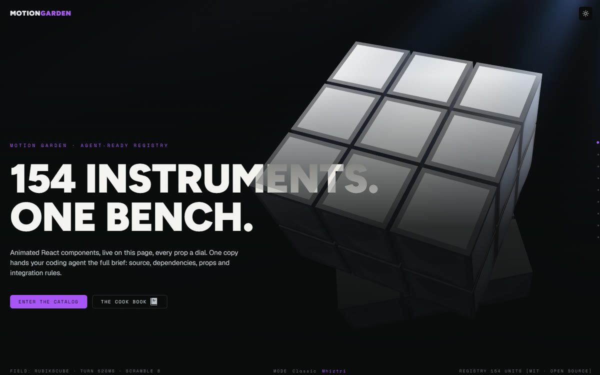
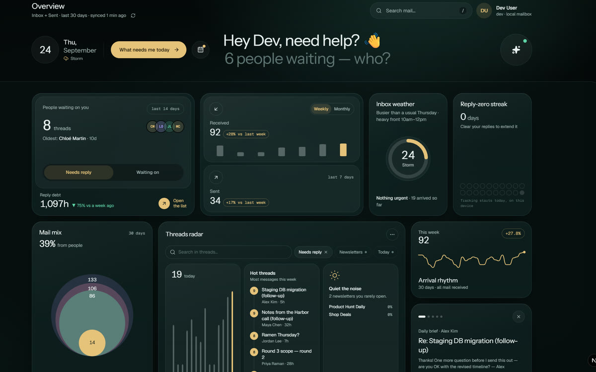
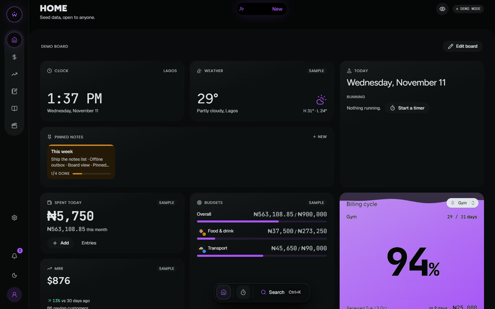
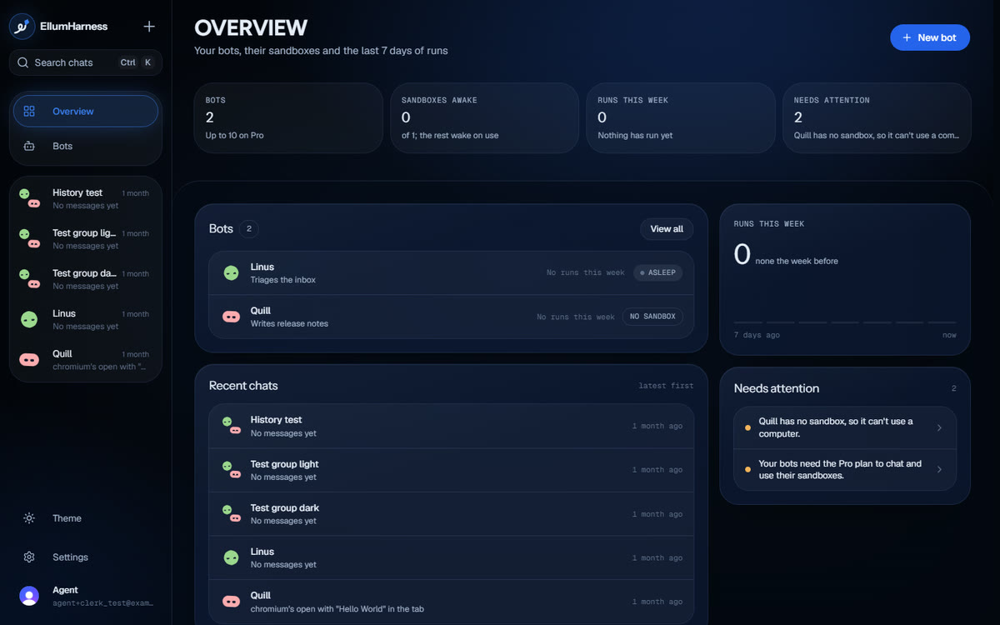
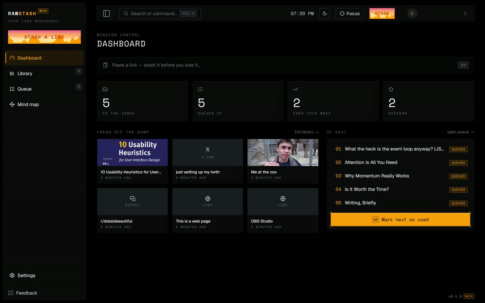
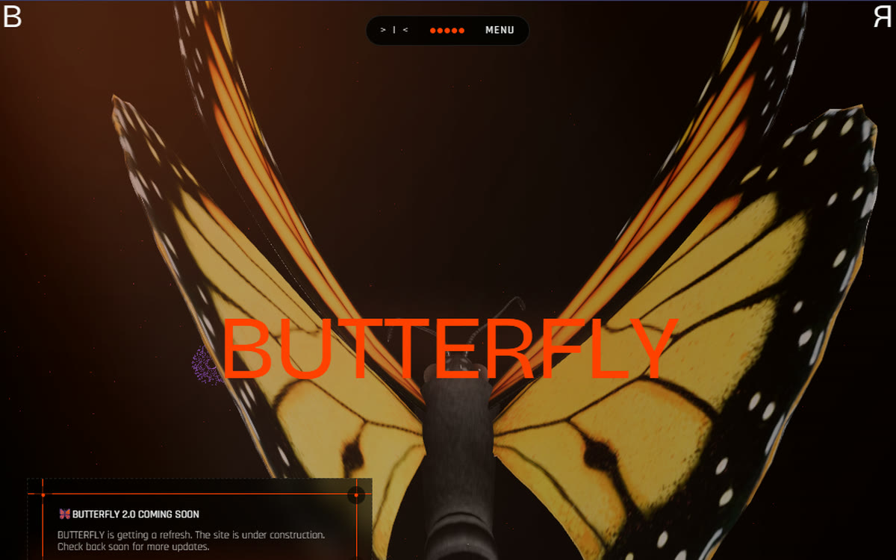

# Isaac Gideon

I'm a frontend-heavy full-stack engineer in Nigeria. Most people online know me as **Vxrcel**.

I've built for the web for over six years, mostly in React, Next.js and TypeScript. I care about how things feel to use: motion, keyboard access, and the small details people only notice when they are missing.

I'm looking for my next role, on a product team that cares how things feel to use.

[Portfolio](https://vxrcel.netlify.app) · [About me](https://vxrcel.netlify.app/about) · [LinkedIn](https://www.linkedin.com/in/isaac-gideon-0813b11b3/) · [X](https://x.com/kleen_pulse)

## My projects

<table>
  <tr>
    <td width="50%" valign="top">
      
        
      <b>Motion Garden</b>
       
      Over 150 animated React components you can tune live on the page. When one looks right, you copy the source or a full brief for your coding agent. Free and open source.
        
      <a href="https://motion-garden.netlify.app">Live</a> · <a href="https://github.com/kleenpulse/shadow-garden">Source</a>
    </td>
    <td width="50%" valign="top">
      
        
      <b>Raven Mail</b>
       
      An open-source email client that shows who is waiting on your reply. It works with Gmail, Outlook, iCloud and any IMAP inbox, and you can host it yourself with Docker.
        
      <a href="https://github.com/kleenpulse/raven-mail">Source</a> · <a href="https://vxrcel.netlify.app/projects/raven-mail">Write-up</a>
    </td>
  </tr>
  <tr>
    <td width="50%" valign="top">
      
        
      <b>Wanheda</b>
       
      A personal dashboard that works like a small operating system. Money, media, reading, read-aloud and notes live in one app.
        
      <a href="https://github.com/kleenpulse/wanheda">Source</a> · <a href="https://vxrcel.netlify.app/projects/wanheda">Write-up</a>
    </td>
    <td width="50%" valign="top">
      
        
      <b>Ellum Harness</b>
       
      Make your own AI bots. Each one gets its own computer in the cloud, and you chat with it while it runs commands and works the screen.
        
      <a href="https://ellum-harness.netlify.app">Live</a> · <a href="https://github.com/kleenpulse/ellum-harness">Source</a> · <a href="https://vxrcel.netlify.app/projects/ellum-harness">Write-up</a>
    </td>
  </tr>
  <tr>
    <td width="50%" valign="top">
      
        
      <b>RawStash</b>
       
      A link stash for people with 40 tabs open. You paste links all week, sort them into a queue, and work through them one at a time.
        
      <a href="https://vxrcel.netlify.app/projects/rawstash">Write-up</a>
    </td>
    <td width="50%" valign="top">
      
        
      <b>Butterfly</b>
       
      A redesign of a crypto venture firm's site, with a 3D butterfly that flies down the page as you scroll.
        
      <a href="https://vxrcel.netlify.app/projects/butterfly">Write-up</a>
    </td>
  </tr>
</table>

## Skills for coding agents

I work with AI coding agents every day. These are skills I wrote for them. All five are MIT licensed.

| Skill | What it does |
| --- | --- |
| [verification-layer](https://github.com/kleenpulse/verification-layer) | Proves an agent-written change works before it is committed. |
| [use-simple-english](https://github.com/kleenpulse/use-simple-english) | Rewrites text into simple, honest English that sounds like a real person wrote it. |
| [motion-pill-jump](https://github.com/kleenpulse/motion-pill-jump) | Fixes the sliding tab pill that jumps or flies in from the wrong place. |
| [create-video-for](https://github.com/kleenpulse/create-video-for) | Makes a video about your project for one viewer, recorded from the real product. |
| [vxrcel-ui-design](https://github.com/kleenpulse/vxrcel-ui-design) | My house design system: quiet chrome, one signal color, three skins. |

## Client and team work

- **[Ellum AI](https://vxrcel.netlify.app/projects/ellumai)**: a client's platform for running a business's social media with AI agents. I wrote most of the content, calendar, analytics and settings pages, and the live notifications.
- **[DeepEllum AI](https://vxrcel.netlify.app/projects/deepellum)**: a client's platform of ready-made AI agents. I was one of three front-end developers. I built most of the signed-in side and most of the admin dashboard.
- **[Aventine](https://vxrcel.netlify.app/projects/aventine)** and **[Bespoke Time](https://vxrcel.netlify.app/projects/bespoke-time)**: two client sites I built from the client's Figma designs, both with a lot of scroll-driven motion.

Every project has a write-up on my portfolio. Each one says what broke and how I fixed it, and ends with my real commit count, so you can see what was mine and what was the team's.

## Smaller things

- [Kilomita](https://github.com/kleenpulse/kilomita): a light internet speed test for Nigeria. It also tells you how much data the test used.
- [Tiny Voca Dashboard](https://github.com/kleenpulse/tiny-voca-dashboard): a local dashboard for a small text-to-speech model. Type text, tune the voice, hear it.

## What I use

<table>
  <tr>
    <td><b>Languages</b></td>
    <td>
      
      
      
      
      
    </td>
  </tr>
  <tr>
    <td><b>Frontend</b></td>
    <td>
      
      
      
      
      
      
      
      
      
    </td>
  </tr>
  <tr>
    <td><b>Backend</b></td>
    <td>
      
      
      
      
      
      
    </td>
  </tr>
  <tr>
    <td><b>Tools</b></td>
    <td>
      
      
      
      
      
      
      
      
      
    </td>
  </tr>
</table>

## Say hello

If your team is hiring, or you want to talk about something I built, [send me a message](https://vxrcel.netlify.app/about).

If my work saved you some time, you can [buy me a coffee](https://buymeacoffee.com/Vxrcel).
